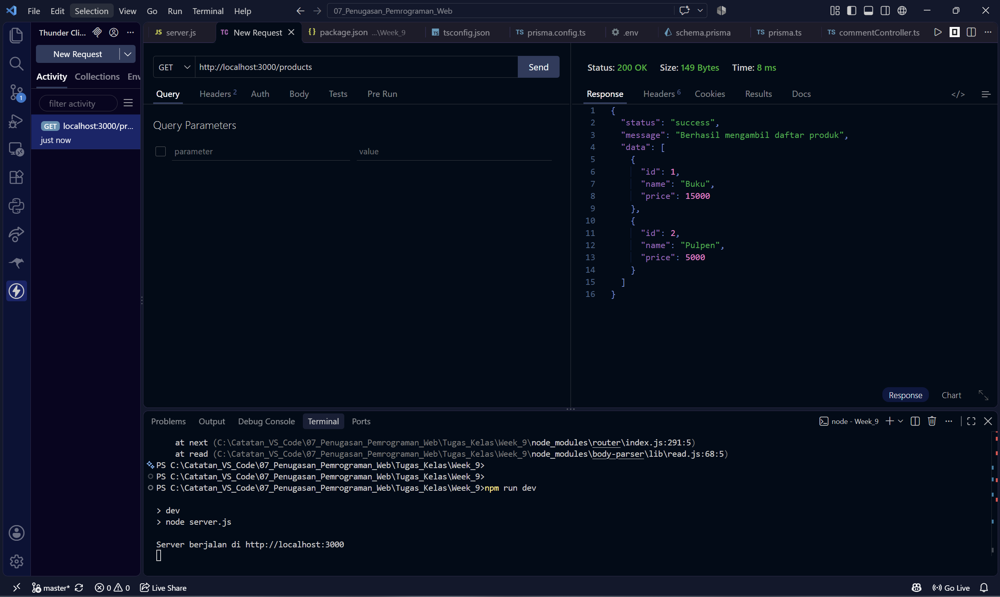
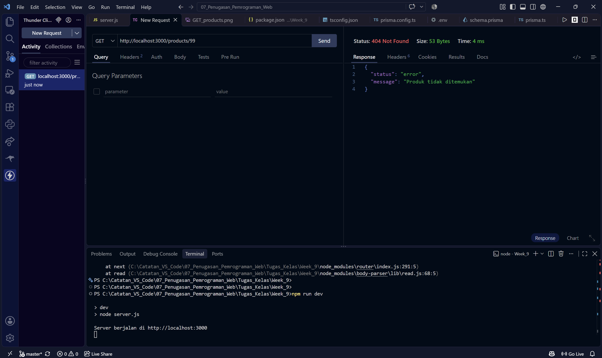
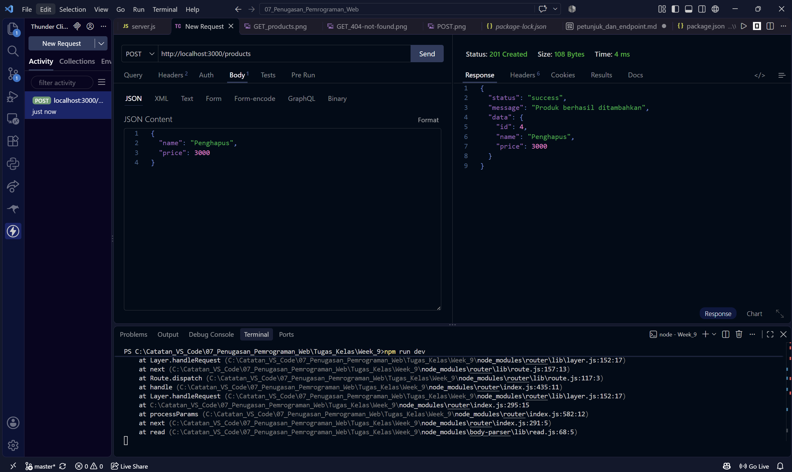
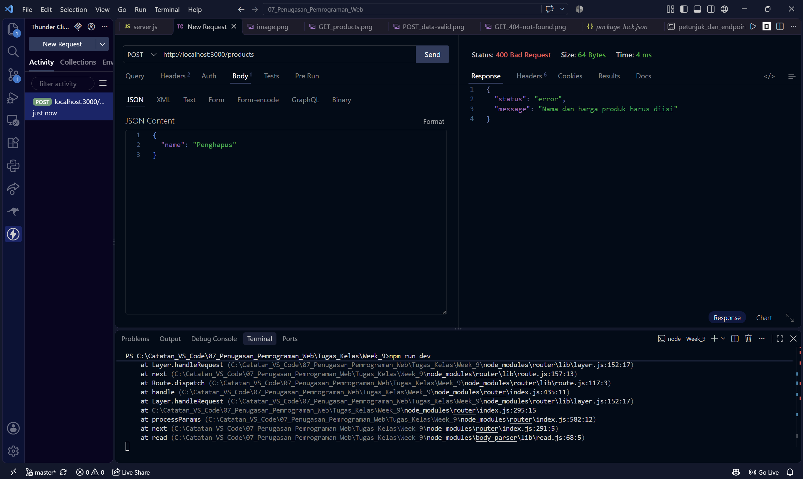

# Expert_Product_API_Pemweb-C-

# Identitas

Pradipta Airlangga Ramadhan
5027251118

## Petunjuk Menjalankan Proyek

### 1. Jalankan Server
Untuk mengaktifkan server Express, jalankan perintah:

```bash
npm run dev
```

## Endpoint API yang ada

### 1. GET /products
* Mengambil seluruh daftar produk.
* **Method**: `GET`
* **URL**: `http://localhost:3000/products`
* **Response (200 OK)**:
> 


### 2. GET /products/:id
* Mengambil data satu produk berdasarkan ID.
* **Method**: `GET`
* **URL**: `http://localhost:3000/products/99` 
* **Response Gagal (404 Not Found)**:
> 

### 3. POST /products
* **Deskripsi**: Menambahkan produk baru ke dalam daftar.
* **Method**: `POST`
* **URL**: `http://localhost:3000/products`
* **Headers**: `Content-Type: application/json`
* **Request Body**:
    ```
    {
    "name": "Penggaris",
    "price": 3000
    }
    ```

* **Request Berhasil**:
> 

* **Request Gagal**:
> 
